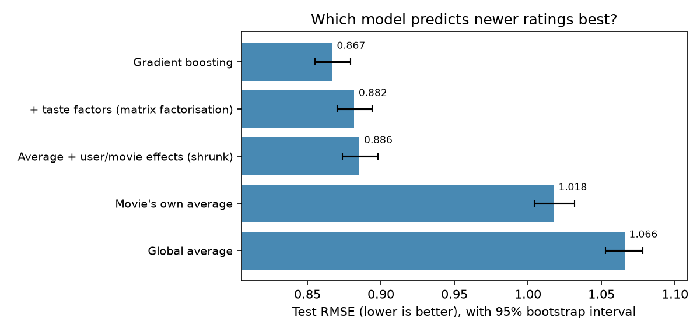
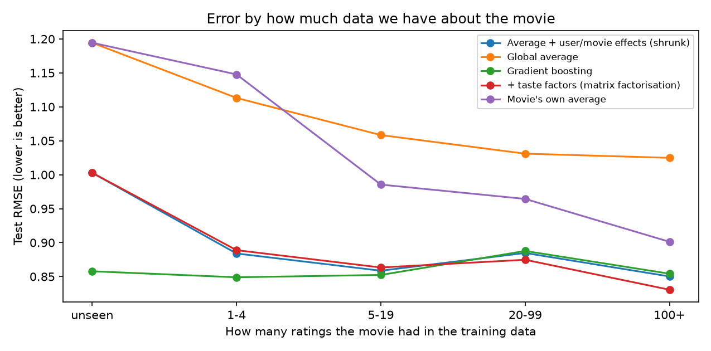

# Predicting movie ratings: which idea actually helps?

I wanted to learn how much each modelling idea really adds, so I started with the dumbest
baseline and added one idea at a time on the public
[MovieLens](https://grouplens.org/datasets/movielens/) "latest-small" data
(about 100k ratings, 610 users, 9.7k movies). Every model is scored on ratings it has never seen,
with an uncertainty interval on every comparison.

## The five models

| # | Model | Idea |
|---|-------|------|
| 1 | Global average | Always predict the overall average. The bar to beat. |
| 2 | Movie's own average | Use each movie's raw average rating. |
| 3 | Average + user/movie effects | Some users are generous, some movies are good. **Shrink** these effects when they rest on few ratings. |
| 4 | + taste factors | Add learned "taste dimensions" (matrix factorisation, ALS). |
| 5 | Gradient boosting | Trees on user/movie statistics, genres and release year. |

## Results

Newest 15% of each user's ratings held out (`per_user_time` split). Lower RMSE is better.

| Model | RMSE | MAE |
|-------|------|-----|
| Global average | 1.066 | 0.835 |
| Movie's own average | 1.018 | 0.785 |
| Average + user/movie effects | 0.886 | 0.683 |
| + taste factors | 0.882 | 0.677 |
| **Gradient boosting** | **0.867** | **0.665** |



**What I learned**

1. **A movie's own average barely helps (1.066 to 1.018).** With only a handful of ratings it is mostly noise. For movies with 1-4 training ratings it is actually *worse* than the global average (1.148 vs 1.113).
2. **Shrinking small-sample averages plus a user effect was the biggest single gain (1.018 to 0.886, 95% CI of the difference +0.124 to +0.141).** Averages built from few ratings are trusted less, and users are not interchangeable.
3. **Taste factors did not clearly help (difference -0.004, 95% CI -0.008 to +0.000).** The interval includes zero, so I can't claim an improvement. The settings that won the tuning hit the edge of my search grid (20 factors, regularisation 0.1), so a wider search might change this.
4. **Gradient boosting won by a small but real margin (-0.019, 95% CI -0.022 to -0.015).** Most of its edge is on movies the model barely knows, where genre, year and the user's habits fill the gap.



## A second evaluation design changed the story

The first split I tried held out the newest ratings *overall*. In MovieLens users rate in bursts,
so 81% of those test ratings came from users with no history at all, and the task became mostly
"new user" prediction. There, gradient boosting wins more clearly (1.024 vs 1.062), and taste factors
add nothing. That is why I report both (`--split global_time` and `--split per_user_time`).
How you test decides which model looks best.

| Model | RMSE, newest ratings overall (mostly new users) | RMSE, each user's newest ratings |
|-------|------|------|
| Global average | 1.104 | 1.066 |
| Movie's own average | 1.065 | 1.018 |
| Average + user/movie effects | 1.062 | 0.886 |
| + taste factors | 1.062 | 0.882 |
| Gradient boosting | 1.024 | 0.867 |

## Things I did to keep it honest

- **Time-based splits**, not random ones. Models never see the future.
- **Out-of-fold features** for gradient boosting: a row's own rating never feeds its own features. A test checks this directly.
- **Tuning on a validation set**, then one score on the untouched test set.
- **Paired bootstrap intervals** on the differences between models.

## Limits

One small dataset and one split per design. Ratings are half-star steps and I treat them as numbers.
I did not use implicit signals (which movies someone chose to rate), and the boosting search is small.

## Next

Use a proper probability model for the shrinkage idea (a hierarchical Bayesian model in PyMC),
and an ordinal likelihood for star ratings.

## Run it

```bash
pip install -r requirements.txt
python -m ratingmodels.run --split per_user_time   # downloads ~1 MB of data on first run
python -m ratingmodels.run --split global_time
pytest
```

Data is downloaded on demand from GroupLens and is not stored in this repo.
